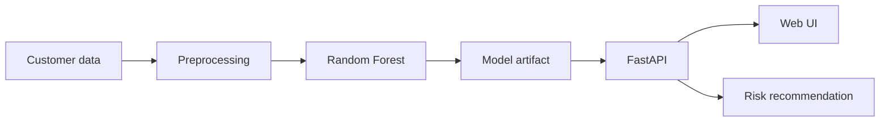

# Customer Churn Classification Platform

An end-to-end ML classification application that predicts customer churn, returns calibrated-style risk probabilities, and translates scores into retention actions. Built as a portfolio project for senior Data Science / ML Engineering roles.

## What this demonstrates
- Reproducible synthetic data generation and feature engineering
- Mixed numeric/categorical preprocessing with `ColumnTransformer`
- Random Forest classification with class balancing
- Accuracy, precision, recall, F1 and ROC-AUC evaluation
- FastAPI inference service with Pydantic validation
- Responsive browser UI for business users
- Dockerized deployment, automated tests and GitHub Actions CI



## Quick start
```bash
python -m venv .venv
# Windows: .venv\\Scripts\\activate
# macOS/Linux: source .venv/bin/activate
pip install -r requirements.txt
python -m ml.train
uvicorn app.main:app --reload
```
Open `http://localhost:8000`.

## API
- `GET /health`
- `GET /model-info`
- `POST /predict`

Example:
```json
{
  "age": 42,
  "tenure_months": 8,
  "monthly_charges": 105,
  "total_charges": 840,
  "support_tickets": 4,
  "contract_type": "Month-to-month",
  "internet_service": "Fiber optic",
  "paperless_billing": "Yes",
  "payment_method": "Electronic check",
  "senior_citizen": 0
}
```

## Production extensions
Feature store integration, model registry, probability calibration, SHAP explanations, drift monitoring and a managed cloud deployment can be added without changing the API contract.

> The dataset is intentionally synthetic and contains no client or personal data.
