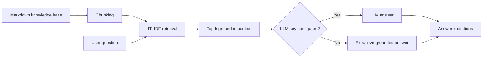

# Enterprise RAG Knowledge Assistant

A full-stack Retrieval-Augmented Generation application for grounded Q&A over enterprise documents. It combines local document ingestion, semantic retrieval, source citations, retrieval evaluation and an optional LLM answer-generation layer.

## Architecture


## Why this project
- Demonstrates the full RAG lifecycle without hiding retrieval behind a framework
- Runs locally with no paid API key required
- Supports optional OpenAI generation through environment configuration
- Includes Hit@K / MRR retrieval evaluation
- Provides FastAPI endpoints and a polished web chat interface
- Docker + tests + CI included

## Run
```bash
python -m venv .venv
# Windows: .venv\\Scripts\\activate
# macOS/Linux: source .venv/bin/activate
pip install -r requirements.txt
uvicorn app.main:app --reload
```
Open `http://localhost:8000`.

Optional LLM generation:
```bash
cp .env.example .env
# set OPENAI_API_KEY
```

## Evaluate retrieval
```bash
python -m eval.evaluate
```

## API
- `GET /health`
- `POST /ask` - `{ "question": "How long are audit logs retained?", "top_k": 3 }`
- `POST /reindex`

## Production extensions
Replace TF-IDF with a vector DB / managed embeddings, add auth, RBAC-aware retrieval, reranking, conversation state, MLflow/LangSmith traces and asynchronous document ingestion.

> Included documents are fictional and intentionally contain no employer/client information.
