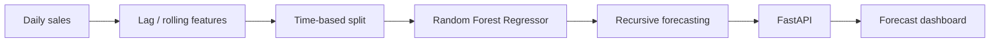

# Retail Demand Forecasting Platform

A full-stack ML forecasting application that predicts item demand for a retail store/product combination and visualizes recent actuals versus a configurable future horizon.

## Skills demonstrated
- Time-aware train/test validation (no random leakage)
- Lag and rolling-window feature engineering
- Calendar, pricing and promotion signals
- Random Forest regression with recursive multi-step forecasting
- MAE / RMSE evaluation
- FastAPI inference endpoint
- Chart.js forecasting dashboard
- Docker, tests and GitHub Actions CI



## Run
```bash
python -m venv .venv
# Windows: .venv\\Scripts\\activate
# macOS/Linux: source .venv/bin/activate
pip install -r requirements.txt
python -m forecasting.train
uvicorn app.main:app --reload
```
Open `http://localhost:8000`.

## API
- `GET /health`
- `GET /metrics`
- `POST /forecast`

Example request:
```json
{"store_id":1,"product_id":2,"horizon":14,"promo":0}
```

## Production extensions
Hierarchical forecasts, probabilistic intervals, MLflow model registry, feature-store materialization, scheduled retraining, drift checks and inventory optimization can be layered onto this architecture.

> All sales history is generated synthetically; no retailer/client data is included.
